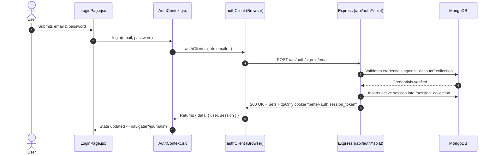

# Better Auth Architecture & Complete Implementation

> Comprehensive technical reference and revision notes based on the **MyJournalApp** full-stack implementation.

---

## 1. What is Better Auth & Why Did We Adopt It?

**Better Auth** is a framework-agnostic, TypeScript-first authentication solution. In this application, it replaces traditional manual JWT and session boilerplate with a unified server-and-client architecture.

### The Contrast: Custom Authentication vs. Better Auth

| Concern | Old Custom JWT Approach | Better Auth Approach |
| :--- | :--- | :--- |
| **Password Security** | Manual `bcrypt.hash()` and salt rounds. | Handled automatically with secure modern hashing algorithms. |
| **Session Tracking** | Signing manual JWTs; writing token refresh loops. | Database-backed sessions stored in MongoDB with automatic expiration. |
| **Cookie Management** | Manual `res.cookie()` with error-prone security flags. | Secure `HttpOnly`, `SameSite`, and SSL cookies configured centrally. |
| **Social Login (OAuth)** | ~80 lines of state checks, exchange codes, and Google APIs. | Zero custom redirect code; fully managed via `socialProviders.google`. |
| **Frontend State** | Polling `/me` in `useEffect` + manual `localStorage`. | Reactive `useSession()` hook that syncs state across browser tabs. |

---

## 2. System Architecture & Database Model

Better Auth coordinates between the React frontend, the Express API layer, and MongoDB:

```
    FRONTEND (React)                   EXPRESS SERVER                   MONGODB ATLAS
┌──────────────────────┐           ┌────────────────────┐           ┌────────────────────┐
│ authClient           │           │ app.js             │           │ user collection    │
│ - signIn.email()     │   HTTP    │ - /api/auth/*splat ├──────────>│ - id, email, name  │
│ - signIn.social()    ├──────────>│   (toNodeHandler)  │           │ - reminderTime, etc│
│ - useSession()       │  Cookies  └─────────┬──────────┘           └────────────────────┘
└──────────────────────┘                     │
                                             ▼                      ┌────────────────────┐
                                   ┌────────────────────┐           │ session collection │
                                   │ authMiddleware     ├──────────>│ - token, userId    │
                                   │ - getSession()     │           │ - expiresAt        │
                                   └─────────┬──────────┘           └────────────────────┘
                                             │
                                             ▼                      ┌────────────────────┐
                                   ┌────────────────────┐           │ account collection │
                                   │ Controllers        ├──────────>│ - password hash    │
                                   │ - read req.userId  │           │ - Google OAuth data│
                                   └────────────────────┘           └────────────────────┘
```

### The 3 Auto-Managed Collections in MongoDB:
1. **`user`**: Stores user identity (`id`, `name`, `email`, plus custom fields like `reminderTime` and `timezone`).
2. **`session`**: Stores active session tokens, user references, IP metadata, and expiration timestamps.
3. **`account`**: Stores credentials (hashed passwords for email/password auth, or provider access tokens for Google OAuth).

---

## 3. Backend Configuration: [`backend/config/auth.js`](file:///c:/Users/mrsan/Desktop/MyJournalApp/backend/config/auth.js)

```javascript
import mongoose from "mongoose"
import { betterAuth } from "better-auth"
import { mongodbAdapter } from "better-auth/adapters/mongodb"
import { username } from "better-auth/plugins"

// 1. Extract database and client from active Mongoose connection
const client = mongoose.connection.getClient()
const db = client.db()

export const auth = betterAuth({
  // 2. Connect to MongoDB using the official adapter
  database: mongodbAdapter(db, {
    client,
  }),

  account: {
    storeStateStrategy: "database",
  },

  // 3. Cookie security configuration
  advanced: {
    useSecureCookies: process.env.NODE_ENV === 'production',
    defaultCookieAttributes: process.env.NODE_ENV === 'production' ? {
      sameSite: "none",
      secure: true,
    } : {},
  },

  // 4. Core auth methods
  emailAndPassword: {
    enabled: true,
  },

  // 5. Plugins
  plugins: [
    username() // Enables sign-in with username alongside email
  ],

  // 6. Schema customization: Add application-specific fields
  user: {
    additionalFields: {
      reminderTime: {
        type: "string",
        required: false,
        defaultValue: null,
      },
      timezone: {
        type: "string",
        required: false,
        defaultValue: "UTC",
      }
    }
  },

  // 7. Social Providers
  socialProviders: {
    google: {
      clientId: process.env.GOOGLE_CLIENT_ID || "",
      clientSecret: process.env.GOOGLE_CLIENT_SECRET || "",
    }
  },

  // 8. CORS & Trusted Origins
  trustedOrigins: [
    "http://localhost:5173",
    "http://localhost:4173",
    process.env.FRONTEND_URL
  ].filter(Boolean)
})
```

### Highlights of This Setup:
- **`user.additionalFields`**: Extends the user model without writing custom Mongoose schemas or manual migrations.
- **`plugins: [username()]`**: Seamlessly adds support for unique usernames during signup and login.
- **`advanced.defaultCookieAttributes`**: In production, enables `sameSite: "none"` and `secure: true` to support cross-site cookies between separated frontend and backend domains.

---

## 4. Express Integration & Routing: [`backend/app.js`](file:///c:/Users/mrsan/Desktop/MyJournalApp/backend/app.js)

Better Auth bridges with Express through its `toNodeHandler(auth)` adapter:

```javascript
// Lines 63-68 in app.js:

// 1. Custom auth routes are defined FIRST
app.put('/api/auth/reminder', authLimiter, express.json(), cookieParser(), authMiddleware, authController.updateReminder)
app.delete('/api/auth/deleteaccount', authLimiter, express.json(), cookieParser(), authMiddleware, authController.deleteAccount)

// 2. Better Auth Catch-All Router
app.all('/api/auth/*splat', toNodeHandler(auth))

// 3. Global middlewares mounted BELOW
app.use(express.json())
app.use(cookieParser())
```

### Two Critical Routing Rules:
1. **Custom Auth Routes Must Come First**:  
   Express evaluates routes in top-down order. If the catch-all `app.all('/api/auth/*splat')` were placed above `/api/auth/reminder`, Better Auth would attempt to handle the reminder endpoint, fail to recognize it, and return a 404.
2. **Mounted Before Global `express.json()`**:  
   Better Auth reads incoming raw request streams natively. If `express.json()` runs first, it consumes the stream, preventing Better Auth from reading request bodies.

---

## 5. Protecting Routes: [`backend/middleware/auth.js`](file:///c:/Users/mrsan/Desktop/MyJournalApp/backend/middleware/auth.js)

Our custom middleware verifies sessions server-side before protected controllers run:

```javascript
import { auth } from "../config/auth.js"
import AppError from "../utils/AppError.js"

async function authMiddleware(req, res, next) {
  try {
    // 1. Extract and verify session from request headers/cookies
    const session = await auth.api.getSession({
      headers: req.headers
    })

    // 2. If no valid session exists in MongoDB, abort with 401
    if (!session || !session.user) {
      return next(new AppError('Unauthorized: Missing or invalid session', 401))
    }

    // 3. Decorate req with user data for downstream controllers
    req.userId = session.user.id
    req.session = session
    next()
  } catch (err) {
    return next(new AppError('Unauthorized: Session verification failed', 401))
  }
}

export default authMiddleware
```

---

## 6. Frontend Integration

### 1. SDK Setup: [`frontend/src/services/auth-client.js`](file:///c:/Users/mrsan/Desktop/MyJournalApp/frontend/src/services/auth-client.js)

```javascript
import { createAuthClient } from "better-auth/react"
import { usernameClient } from "better-auth/client/plugins"

export const authClient = createAuthClient({
  baseURL: import.meta.env.VITE_API_URL || "http://localhost:3000",
  plugins: [
    usernameClient()
  ]
})
```

---

### 2. State & Session Management: [`frontend/src/context/AuthContext.jsx`](file:///c:/Users/mrsan/Desktop/MyJournalApp/frontend/src/context/AuthContext.jsx)

The context wraps Better Auth's reactive hook and actions for the UI:

```javascript
export function AuthProvider({ children }) {
  const [currentUser, setCurrentUser] = useState(null)
  const [loading, setLoading] = useState(true)

  // Reactive hook monitors session cookie automatically
  const sessionQuery = authClient.useSession()
  const session = sessionQuery?.data
  const isPending = sessionQuery?.isPending

  useEffect(() => {
    if (!isPending) {
      if (session?.user) {
        setCurrentUser({
          id: session.user.id,
          email: session.user.email,
          username: session.user.username || session.user.name || "",
          reminderTime: session.user.reminderTime,
          timezone: session.user.timezone,
        })
      } else {
        setCurrentUser(null)
      }
      setLoading(false)
    }
  }, [session, isPending])

  async function login(email, password) {
    const { data, error } = await authClient.signIn.email({ email, password })
    if (error) throw new Error(error.message || "Failed to log in")
    if (data?.user) setCurrentUser(data.user)
  }

  async function signup(email, username, password) {
    const { data, error } = await authClient.signUp.email({
      email,
      password,
      username,
      name: username
    })
    if (error) throw new Error(error.message || "Failed to sign up")
    if (data?.user) setCurrentUser(data.user)
  }

  async function logout() {
    await authClient.signOut()
    setCurrentUser(null)
  }

  return (
    <AuthContext.Provider value={{ currentUser, loading, login, signup, logout }}>
      {loading ? <LoadingSpinner /> : children}
    </AuthContext.Provider>
  )
}
```

---

## 7. Live End-to-End User Flows

### Flow 1: Email & Password Login


---

### Flow 2: Authenticated API Requests (e.g. Fetching Journals)
1. Frontend makes request:
   ```javascript
   const res = await fetch("http://localhost:3000/api/journals", {
     credentials: "include" // Attaches the HttpOnly session cookie
   })
   ```
2. Request hits [`backend/middleware/auth.js`](file:///c:/Users/mrsan/Desktop/MyJournalApp/backend/middleware/auth.js).
3. `auth.api.getSession({ headers })` reads the cookie and queries MongoDB's `session` collection.
4. If valid, attaches `req.userId` and proceeds to `journalController.getByUser`.

---

### Flow 3: Page Reload (Auto-Session Recovery)
1. User presses **F5** (Page reload).
2. React initializes; `loading` is `true` and renders the spinner.
3. `authClient.useSession()` immediately fires in the background, sending `GET /api/auth/get-session` with the session cookie.
4. Backend returns the active session.
5. `isPending` transitions to `false`, `currentUser` is restored, and the user stays authenticated without a redirect.

---

### Flow 4: Google Social Login
```javascript
// In LoginPage.jsx
await authClient.signIn.social({
  provider: "google",
  callbackURL: `${window.location.origin}/journals`
})
```
1. Better Auth generates the OAuth URL and redirects to Google's consent screen.
2. User approves access.
3. Google redirects back to `GET /api/auth/callback/google`.
4. Better Auth exchanges the auth code for profile info, creates or links the account in MongoDB, issues an `HttpOnly` session cookie, and redirects the browser back to `/journals`.

---

## 8. Interview Questions & Answers

### Q1: What is Better Auth and how does it compare to custom JWT auth?
**Answer:**
Better Auth is a modern, unified authentication framework. While custom JWT implementations require manually handling password hashing with `bcrypt`, generating and signing tokens, managing refresh token rotations, and building custom OAuth state exchanges, Better Auth provides a centralized server configuration with an integrated client SDK. It handles database-backed sessions, secure cookie management, and social logins out of the box.

---

### Q2: How does Better Auth store and validate user sessions?
**Answer:**
Better Auth uses database-persisted sessions. When a user authenticates, a record containing a secure session token, user ID, and expiration date is created in the MongoDB `session` collection. The token is sent to the client as an `HttpOnly` cookie. On incoming requests, `auth.api.getSession({ headers: req.headers })` validates the token against the database, enabling immediate session revocation if needed.

---

### Q3: Why must custom auth endpoints precede `app.all('/api/auth/*splat')` in Express?
**Answer:**
Express matches routes in the order they are defined. `toNodeHandler(auth)` is mounted as a wildcard catch-all on `/api/auth/*splat`. If custom endpoints (like `/api/auth/reminder` or `/api/auth/deleteaccount`) were registered below it, Better Auth would intercept them first and return a 404, preventing custom controller handlers from executing.

---

### Q4: Why is Better Auth mounted before `express.json()` in `app.js`?
**Answer:**
Better Auth reads incoming raw request streams natively. Mounting `express.json()` above it would consume and buffer the body stream, leaving Better Auth unable to read the request payload. Placing the catch-all before global body-parser middlewares ensures raw streams reach Better Auth intact.

---

### Q5: How do you add custom fields to the user model in Better Auth?
**Answer:**
You declare them inside `user.additionalFields` in the server configuration (`backend/config/auth.js`):
```javascript
user: {
  additionalFields: {
    reminderTime: { type: "string", required: false, defaultValue: null },
    timezone: { type: "string", required: false, defaultValue: "UTC" }
  }
}
```
Better Auth automatically extends its database schemas, serialization logic, and client responses to include these fields.
