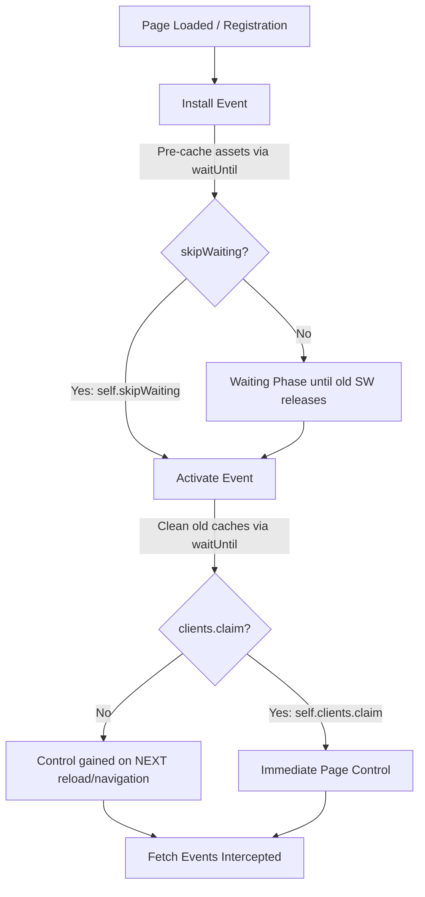
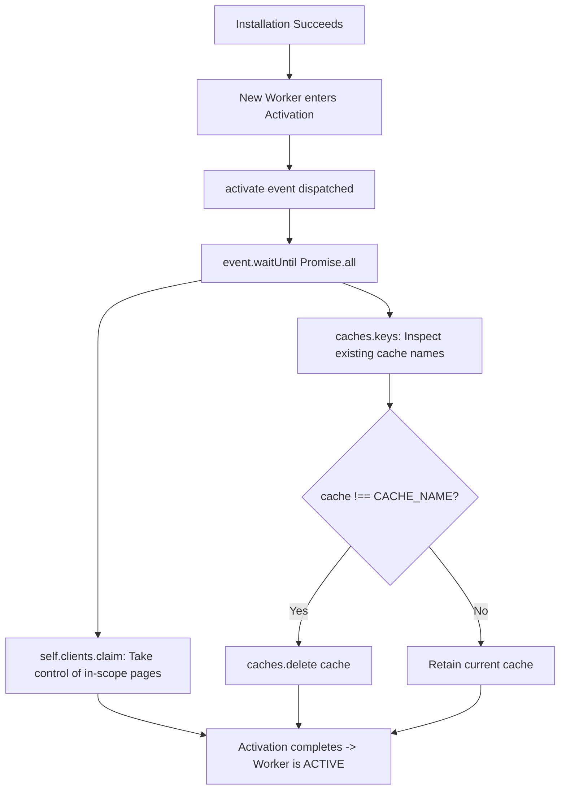
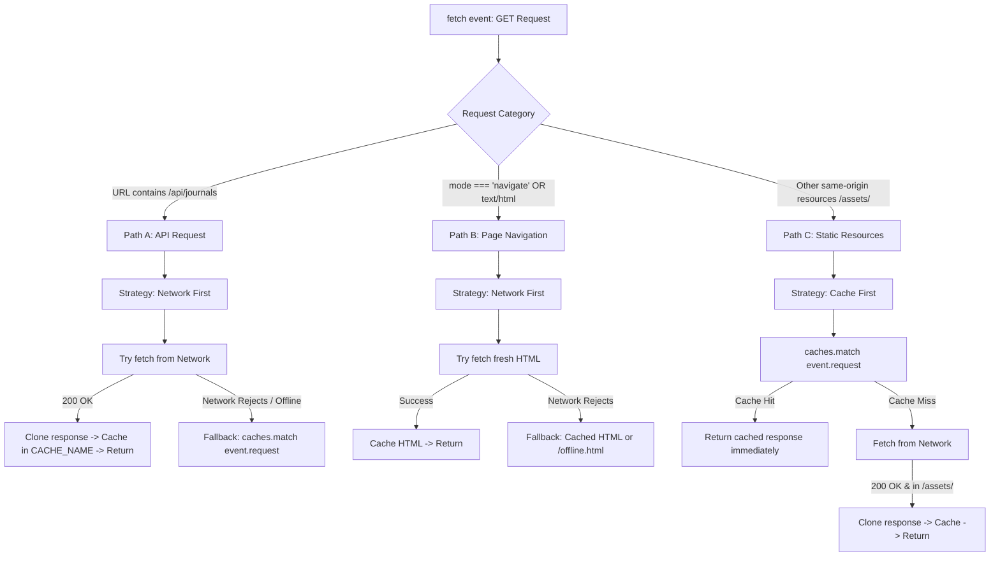

# PWA Service Worker — 4 Core Processes & Lifecycle

Understanding what the browser does, why each event fires, and what each line of code accomplishes in `frontend/public/sw.js`.

---

## High-Level Overview: The 4 Stages

| Stage | Type | Description |
| :--- | :--- | :--- |
| **1. Install** | Lifecycle Event | The browser installs a new service worker. Prepares essential resources (pre-caching). |
| **2. Activate** | Lifecycle Event | The new worker takes over the active role and cleans up outdated caches. |
| **3. Control** | State (Relationship) | The active service worker becomes the controller for a page, intercepting eligible requests. |
| **4. Fetch** | Functional Event | The worker receives eligible requests and decides whether to use network, cache, or fallback. |

> **Key Distinction**: Control is a **state**, not a lifecycle event like `install` or `activate`.



---

## Part 1 — Install

The browser installs a new service worker and sets up essential resources.

### 1.1 What Triggers the `install` Event?

In `frontend/src/main.jsx`:

```javascript
if ('serviceWorker' in navigator) {
  window.addEventListener('load', () => {
    navigator.serviceWorker.register('/sw.js')
      .then((registration) => {
        console.log('Service Worker registered:', registration.scope)
      })
      .catch((error) => {
        console.error('Registration failed:', error)
      })
  })
}
```

#### Lifecycle Trace:
1. The browser loads the application.
2. After the page's `load` event, code calls `register('/sw.js')`.
3. The browser fetches and checks the service worker script.
4. If it is a new worker (or the script changed by at least 1 byte), the browser begins installing it and dispatches the `install` event.

> **Important**:
> - Registration does **not** mean installation has succeeded.
> - Installation does **not** mean the page is already controlled.
> - These are separate stages.

---

### 1.2 Breakdown of the Install Handler

Code in `frontend/public/sw.js`:

```javascript
const CACHE_NAME = 'journal-cache-v10'

const ASSETS_TO_CACHE = [
  '/',
  '/index.html',
  '/offline.html',
  '/manifest.json',
  '/favicon.svg',
  '/icons/icon-192.png',
  '/icons/icon-512.png',
  '/screenshots/screenshot-desktop.png',
  '/screenshots/screenshot-mobile.png'
]

self.addEventListener('install', (event) => {
  event.waitUntil(
    caches.open(CACHE_NAME)
      .then((cache) => cache.addAll(ASSETS_TO_CACHE))
  )

  self.skipWaiting()
})
```

#### Line-by-Line Breakdown:

- **`self.addEventListener('install', ...)`**  
  `self` refers to the service worker's own global execution context. Instructs the browser: *When this service worker enters its installation phase, execute this handler.*

- **`caches.open(CACHE_NAME)`**  
  Opens the named cache (`journal-cache-v10`), creating it if it doesn't already exist.

- **`cache.addAll(ASSETS_TO_CACHE)`**  
  Fetches the listed URLs and stores their successful responses in the cache.  
  *Critical behavior*: If even a single required resource fails to fetch, the entire operation rejects, and installation fails.

- **`event.waitUntil(...)`**  
  Tells the browser: *The installation is not complete until this promise settles.*  
  Without `waitUntil()`, the browser would not wait for the caching operation to finish before marking installation as complete. If the promise passed to `waitUntil()` rejects, the service worker installation fails and is discarded.

- **`self.skipWaiting()`**  
  Requests that this newly installed worker skip the standard waiting phase and proceed directly to activation without waiting for existing open tabs to close.  
  *Note*: It does **not** mean installation is finished immediately, nor does it immediately control open pages by itself.

---

### 1.3 Install Process Flow

```mermaid
flowchart TD
    A[Browser detects new / updated worker] --> B[register('/sw.js')]
    B --> C[install event fires]
    C --> D[caches.open CACHE_NAME]
    D --> E[cache.addAll ASSETS_TO_CACHE]
    E --> F{All assets fetched successfully?}
    F -->|Yes| G[Installation succeeds]
    F -->|No: Promise rejects| H[Installation FAILS & worker discarded]
    G --> I[self.skipWaiting called]
    I --> J[Proceeds directly toward Activation]
```

---

### 1.4 Test Your Understanding: Install

**Scenario**: Suppose `cache.addAll(ASSETS_TO_CACHE)` fails because `/offline.html` cannot be fetched (e.g. 404 or network drop). What happens?

> **Answer**: **The installation fails.**  
> Because `event.waitUntil()` is awaiting the promise returned by `cache.addAll()`. An error on any single asset causes the entire promise to reject, aborting installation.

---

## Part 2 — Activate

Once installation succeeds, the new worker takes over the active role and performs maintenance (such as clearing outdated caches).

```
Install → Waiting → Activate → Active
```

Normally, a new worker waits if an older worker is still controlling open pages. `self.skipWaiting()` bypasses this. Once eligible to take over, the browser fires the `activate` event.

---

### 2.1 Breakdown of the Activate Handler

Code in `frontend/public/sw.js`:

```javascript
self.addEventListener('activate', (event) => {
  event.waitUntil(
    Promise.all([
      self.clients.claim(),

      caches.keys().then((cacheNames) =>
        Promise.all(
          cacheNames.map((cache) => {
            if (cache !== CACHE_NAME) {
              return caches.delete(cache)
            }
          })
        )
      )
    ])
  )
})
```

#### Core Components:

#### A. `caches.keys()` — Discover Existing Caches
Inspects the Cache Storage for the origin:
```
Cache Storage
├── journal-cache-v9
├── journal-cache-v10
└── journal-cache-v11
```
`caches.keys()` returns a promise that resolves to an array of all cache name strings.

#### B. `caches.delete(cache)` — Delete Stale Caches
Iterates over every existing cache name:
```javascript
if (cache !== CACHE_NAME) {
  return caches.delete(cache)
}
```
If current version is `journal-cache-v11`, older caches like `journal-cache-v10` and `journal-cache-v9` are purged. Outdated cached files consume storage and might conflict with the new application bundle.

> **Caution**: The code above deletes *any* cache on the origin whose name does not match `CACHE_NAME`. If other features or sub-apps on the same origin maintain their own caches, the cleanup logic should specifically filter by an application-specific prefix (e.g., `cache.startsWith('journal-cache-') && cache !== CACHE_NAME`).

#### C. `self.clients.claim()` — Claim Open Clients
Requests that the newly activated service worker immediately take control of all eligible, in-scope open tabs/pages without requiring the user to reload the page.

---

### 2.2 Why Use `event.waitUntil()` in Activation?

```javascript
event.waitUntil(
  Promise.all([
    self.clients.claim(),
    cleanupOldCaches()
  ])
)
```
- Keeps the `activate` event alive until all supplied promises settle.
- `Promise.all()` ensures both the client claim and cache deletion complete before the worker is considered fully active.
- If any operation fails, the activation promise rejects.

---

### 2.3 Activation Process Flow



---

### 2.4 Test Your Understanding: Activate

**Scenario**: Suppose `journal-cache-v10` and `journal-cache-v11` both exist, and `CACHE_NAME` is set to `journal-cache-v11`. What does the cleanup code do?

> **Answer**: **It deletes `journal-cache-v10` and keeps `journal-cache-v11`.**  
> It does not merge them or wait for browser heuristics. It actively deletes any cache key that does not match `CACHE_NAME`.

---

## Part 3 — Control (Service Worker State)

Control represents the actual operational connection between the active service worker and open client pages.

---

### 3.1 What Does "Controlling a Page" Mean?

When a user visits `https://myjournalapp.vercel.app/`:

| Page Status | Behavior |
| :--- | :--- |
| **Uncontrolled Page** | Browser handles all requests normally via network. No service worker intercepts `fetch` events. |
| **Controlled Page** | The service worker intercepts eligible network requests. The worker's `fetch` handler decides whether to serve from cache, network, or fallback. |

- **Active**: Describes the **worker's** lifecycle state.
- **Controlled**: Describes the **relationship** between that worker and a specific page/client.

An active service worker does not automatically control an already open page unless claimed or reloaded.

---

### 3.2 First-Visit Lifecycle & Why It Starts Uncontrolled

When a brand-new user visits for the first time:

1. **User opens page**: Browser downloads initial HTML/CSS/JS via standard network. No service worker exists yet.
2. **React loads & registers `/sw.js`**: `main.jsx` calls `navigator.serviceWorker.register('/sw.js')` on the `window` `load` event.
3. **SW Installs & Activates**: `install` and `activate` fire in the background worker thread.
4. **Active worker claims page**:
   - **With `self.clients.claim()`**: The active worker takes control of the currently open tab immediately. Subsequent requests are intercepted without reloading.
   - **Without `clients.claim()`**: The page remains **uncontrolled** for the remainder of that session. The worker only gains control upon the next page navigation or manual reload.

> **Note**: Requests that already completed prior to claiming cannot be retroactively intercepted. Only subsequent requests are handled.

---

### 3.3 Inspecting Control in the Browser

Check whether the current page is controlled via Chrome DevTools Console:

```javascript
console.log(navigator.serviceWorker.controller)
```

**Output Scenarios**:
- `null`: The current page is **not** controlled.
- `ServiceWorker { scriptURL: "...", state: "activated" }`: The page is controlled.

To detect when a worker takes control dynamically:

```javascript
navigator.serviceWorker.addEventListener('controllerchange', () => {
  console.log('New controller taken over:', navigator.serviceWorker.controller)
})
```

---

### 3.4 Key Difference: `skipWaiting()` vs `clients.claim()`

| API | Executed In | Primary Purpose | Mental Shortcut |
| :--- | :--- | :--- | :--- |
| **`self.skipWaiting()`** | `install` listener | Bypasses the waiting state to activate the new worker immediately. | *Become active sooner* |
| **`self.clients.claim()`** | `activate` listener | Takes immediate control of open, uncontrolled client pages without requiring a reload. | *Take control of pages now* |

Neither function guarantees requests are intercepted by itself; requests must be eligible and handled in the `fetch` listener of a controlled page.

---

### 3.5 What is a Client?

In service worker terminology, a **client** is an execution context (an open tab, an `<iframe>`, or a shared worker) matching the origin and scope:

```
Browser
├── Tab A: MyJournalApp (/)       ← Controlled Client
├── Tab B: MyJournalApp (/notes)  ← Controlled Client
└── Tab C: YouTube               ← Unrelated Origin (Not a Client)
```

A single service worker registration controls multiple tabs/clients across the same scope simultaneously.

---

### 3.6 Scope Rules

Because registration is called as:
```javascript
navigator.serviceWorker.register('/sw.js')
```
And `/sw.js` is served from the root domain `/`, its default scope is `/`.

- **Can control**: `/`, `/dashboard`, `/journals`, and any sub-path on that origin.
- **Cannot control**: Pages on different domains/origins.
- **Cross-origin requests**: A controlled page making requests to an external API (e.g. backend server or CDN) will still dispatch `fetch` events to its controlling service worker.

---

## Part 4 — Fetch: Request Interception & Caching Strategies

Once a page is controlled, outgoing requests produce `fetch` events inside the service worker.

### 4.1 How a Request Reaches `sw.js`

```
React Application (e.g. fetch('/api/journals'))
      │
      ▼
Browser checks: Is page controlled?
      │
      ├─► [NO] ──► Normal network request directly
      │
      └─► [YES]
            │
            ▼
      sw.js `fetch` event dispatched
            │
            ▼
      Worker evaluates URL, method, headers
            │
      ┌─────┴────────────────┐
      ▼                      ▼
  Network First          Cache First
(API / Navigations)    (Static Assets)
      │                      │
      └──────────┬───────────┘
                 ▼
      Response returned to React
```

---

### 4.2 The `fetch` Event Listener: Entry & Filtering

```javascript
self.addEventListener('fetch', (event) => {
  if (event.request.method !== 'GET') {
    return
  }

  const url = event.request.url

  // Routing strategies applied below...
})
```

#### Key Details:
- **`event.request`**: The `Request` object containing URL, HTTP method, headers, and credentials.
- **Filtering non-GET requests**: Requests like `POST /api/journals`, `PUT`, or `DELETE` mutate database state and must not be served from static caches.
- **The early `return`**: Exiting without calling `event.respondWith()` does **not** cancel the request. It signals the browser to fall back to default network handling.

---

### 4.3 The Critical API: `event.respondWith()`

```javascript
self.addEventListener('fetch', (event) => {
  event.respondWith(fetch(event.request))
})
```

- **Without `respondWith()`**: The listener merely observes the request (like logging) while the browser fetches normally.
- **With `respondWith(promise)`**: The service worker hijacks the response pipeline, fulfilling the request with whatever `Response` object the provided promise resolves to (from cache, network, or custom generated fallback).

> **Distinction**:
> - `event.respondWith()` &rarr; Hijacks and supplies the HTTP response to the client.
> - `event.waitUntil()` &rarr; Keeps the worker process alive to complete background asynchronous work.

---

### 4.4 The 3 Routing Paths in MyJournalApp



---

### Detailed Path Implementations

#### Path A: Journal API (`/api/journals`) — Network First

```javascript
if (url.includes('/api/journals')) {
  event.respondWith(
    fetch(event.request)
      .then((networkResponse) => {
        if (networkResponse.status === 200) {
          const responseToCache = networkResponse.clone()

          caches.open(CACHE_NAME).then((cache) => {
            cache.put(event.request, responseToCache)
          })
        }

        return networkResponse
      })
      .catch(() => {
        return caches.match(event.request, {
          ignoreSearch: true
        })
      })
  )

  return
}
```

- **Online**: Hits server, writes cloned response with status 200 to cache, returns fresh data to React.
- **Offline / Network failure**: The fetch promise rejects, triggering `.catch()`. Serves cached journal data via `caches.match()`.
- **Implementation Caveats**:
  1. An HTTP `500 Internal Server Error` does **not** trigger `.catch()`. The network transport succeeded; only network drops, DNS errors, or aborted requests cause rejection.
  2. The cache write `cache.put()` is not wrapped in `event.waitUntil()`, meaning the worker lifecycle might terminate before the write operation finishes under heavy memory pressure.

---

#### Path B: Navigation Requests — Network First

Identified via request properties:
```javascript
const isNavigation =
  event.request.mode === 'navigate' ||
  event.request.headers.get('accept')?.includes('text/html')
```

- **Online**: Fetches latest HTML shell from server so the user always has up-to-date scripts and markup.
- **Offline**: Network fails &rarr; returns cached HTML or `/offline.html` placeholder.
- **Requirement**: Having the HTML alone does not make the app work offline; bundled JS/CSS assets and API data must also be available.

---

#### Path C: Static Assets (`/assets/`) — Cache First

```javascript
caches.match(event.request, {
  ignoreSearch: true
}).then((cachedResponse) => {
  if (cachedResponse) {
    return cachedResponse
  }

  return fetch(event.request).then((networkResponse) => {
    if (
      networkResponse.status === 200 &&
      url.includes('/assets/')
    ) {
      const responseToCache = networkResponse.clone()

      caches.open(CACHE_NAME).then((cache) => {
        cache.put(event.request, responseToCache)
      })
    }

    return networkResponse
  })
})
```

- **Cache Hit**: Returns cached JavaScript, CSS, or image instantly without network traffic.
- **Cache Miss**: Fetches from network, caches a clone for future visits, and returns response.
- **Lookup scope**: `caches.match(request)` searches across **all** caches for the origin by default unless targeted to a specific cache object.

---

### 4.5 Core Method Comparison Table

| Method / API | Scope / Context | Purpose |
| :--- | :--- | :--- |
| **`fetch(event.request)`** | Network | Issues a standard HTTP network request. |
| **`caches.match(request)`** | Storage | Checks Cache Storage for a pre-existing matching request/response pair. |
| **`event.respondWith(promise)`** | Request Lifecycle | Overrides default browser network behavior with a custom response promise. |
| **`event.waitUntil(promise)`** | Worker Lifecycle | Extends the active lifetime of an event until asynchronous tasks complete. |
| **`response.clone()`** | Response Streams | Duplicates a `Response` stream, allowing one copy to be returned to the browser and the other saved to Cache Storage. |

---

### 4.6 Test Your Understanding: Fetch

**Scenario**: The application requests `/assets/index-abc123.js`. The file is already stored in Cache Storage under `journal-cache-v10`, and the service worker implements Cache First.

What happens?
> **Answer**: **The service worker returns the cached response immediately without dispatching any network request.**

---

## Complete Mental Model Summary

```
[Register]
   │
   ▼
[Install] ──► Pre-cache core shell (event.waitUntil) ──► self.skipWaiting()
   │
   ▼
[Activate] ──► Purge stale caches (caches.delete) ──► self.clients.claim()
   │
   ▼
[Control] ──► Open tabs become controlled clients (navigator.serviceWorker.controller)
   │
   ▼
[Fetch] ──► Intercept GET requests (event.respondWith):
                 ├── API: Network First (Cache fallback)
                 ├── Navigation: Network First (/offline.html fallback)
                 └── Static Assets: Cache First (Network fallback + dynamic cache)
```
