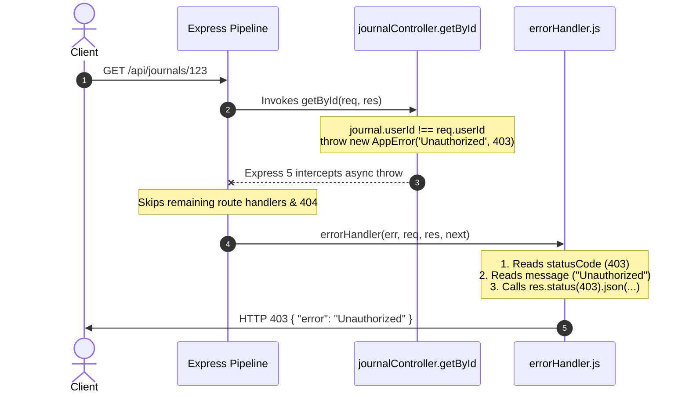

# Centralized Global Error Handling

> Revision notes and technical reference based on the **MyJournalApp** backend architecture.

---

## 1. Why Do We Need a Global Error Handler?

### The Core Problem: JavaScript Errors vs. HTTP Responses
Throwing an error is strictly an **internal JavaScript event inside your Node.js runtime**. 

A client (such as a browser, mobile app, or frontend frontend UI) is waiting on an open **HTTP connection**. An HTTP connection has no knowledge of JavaScript stack traces or `throw` statements. It only understands:
1. An **HTTP Status Code** (e.g. `400`, `401`, `403`, `404`, `500`)
2. Headers (`Content-Type: application/json`)
3. A **Response Body** (`{ "error": "Unauthorized" }`)

If no function in your application catches the error and explicitly invokes `res.status(...).json(...)`, the HTTP response is never properly resolved by your application code.

---

### What Happens If You Simply `throw new Error(...)` Without a Handler?

1. **Express Falls Back to Raw HTML**:  
   Express steps in with its default fallback and sends an HTML document containing the stack trace:
   ```html
   <!DOCTYPE html>
   <html>
     <head><title>Error</title></head>
     <body>
       <pre>Error: Unauthorized access
           at getById (file:///backend/controllers/journalController.js:13:11)
       </pre>
     </body>
   </html>
   ```
2. **Frontend Applications Crash**:  
   Frontend clients parsing responses via `await res.json()` fail with:
   `SyntaxError: Unexpected token '<', "<!DOCTYPE "... is not valid JSON`
3. **Status Codes Default to 500**:  
   JavaScript's built-in `Error` has no HTTP status code concept. Express defaults to sending **500 Internal Server Error**, even when the error was a client mistake like missing input (`400`) or missing credentials (`401`).
4. **Security Leak**:  
   Internal server paths, database queries, and system details are directly exposed to the public.

---

## 2. Before vs. After: Local vs. Centralized Error Handling

### 🔴 Before: Local Error Handling (Without Centralized Handler)
Every controller must maintain repetitive `try/catch` boilerplate, manually pick status codes, and format error JSON:

```javascript
// ❌ Repeated in every single controller method
export async function getById(req, res) {
  try {
    const journal = await journalService.getById(req.params.id)
    if (!journal) {
      return res.status(404).json({ error: 'Journal not found' })
    }
    if (journal.userId !== req.userId) {
      return res.status(403).json({ error: 'Forbidden' })
    }
    return res.status(200).json(journal)
  } catch (err) {
    console.error(err)
    return res.status(500).json({ error: 'Internal Server Error' })
  }
}
```

**Consequences**:
- **Code bloat**: 15–20 lines of repetitive boilerplate per endpoint.
- **Inconsistent response schemas**: Different controllers return `{ error: ... }`, `{ message: ... }`, or `{ msg: ... }`.
- **Missed errors**: Any unhandled rejection outside a `try/catch` triggers Express's default HTML fallback.

---

### 🟢 After: Centralized Error Handling (Our Codebase)
Controllers contain **no** `try/catch` blocks and **no** response formatting for errors. They focus purely on happy-path business logic:

```javascript
// ✅ Clean, concise business logic (backend/controllers/journalController.js)
export async function getById(req, res) {
  const journal = await journalService.getById(req.params.id)

  if (journal.userId !== req.userId) {
    throw new AppError('Unauthorized access to this journal', 403)
  }

  res.json(journal)
}
```

**Benefits**:
- Controllers remain readable and minimal.
- Every error in the system outputs the exact same JSON format: `{ error: string, details?: any }`.
- Changing the response structure across the entire API requires updating exactly **one file** (`errorHandler.js`).

---

## 3. The 3-Piece Architecture in Our Codebase

```
1. AppError.js               2. Express 5 Engine              3. errorHandler.js
(Data Carrier)               (Transit / Catch)                (HTTP Spokesperson)

┌───────────────────────┐    ┌───────────────────────────┐    ┌─────────────────────────────────────────┐
│ class AppError        │    │ Intercepts throw          │    │ function errorHandler(err,req,res,next) │
│ - message             ├───>│ Bypasses regular routes   ├───>│ - extracts statusCode & message         │
│ - statusCode (400-500)│    │ Hands err to error handler│    │ - res.status(code).json(response)       │
│ - details (optional)  │    └───────────────────────────┘    └─────────────────────────────────────────┘
└───────────────────────┘
```

---

### Piece 1: The Data Carrier — [`backend/utils/AppError.js`](file:///c:/Users/mrsan/Desktop/MyJournalApp/backend/utils/AppError.js)

```javascript
class AppError extends Error {
  constructor(message, statusCode, details = null) {
    super(message)
    this.statusCode = statusCode
    this.details = details
  }
}

export default AppError
```

#### What `AppError` Does (and Does NOT Do):
- **`AppError` does NOT handle errors.** It does not send HTTP responses or log to consoles.
- **It is a data envelope.** It extends standard `Error` and attaches two properties:
  1. `statusCode`: The HTTP code (`400`, `401`, `403`, `404`).
  2. `details`: Optional structured payload (e.g. Zod validation failure lists).

When `new AppError('Forbidden', 403)` is instantiated, it produces an in-memory object:
```javascript
{
  message: 'Forbidden',
  statusCode: 403,
  details: null,
  stack: 'Error: Forbidden at ...'
}
```

---

### Piece 2: The Transport Layer — Express 5 Native Async Catching

In **Express 5** (`package.json`: `"express": "^5.2.1"`), any rejection or `throw` inside an `async` route handler is **automatically caught** by Express and routed to the error middleware:

```javascript
// Express 5 intercepts this automatically without needing try/catch or wrapper libraries
export async function create(req, res) {
  const { title } = req.body
  if (!title) {
    throw new AppError('title required', 400)
  }
  const journal = await journalService.create(req.userId, title)
  res.status(201).json(journal)
}
```

> **In Express 4**: Throwing inside an `async` function resulted in an unhandled promise rejection; an `asyncHandler` wrapper or explicit `try/catch` calling `next(err)` was mandatory. Express 5 removes this requirement.

---

### Piece 3: The Spokesperson — [`backend/middleware/errorHandler.js`](file:///c:/Users/mrsan/Desktop/MyJournalApp/backend/middleware/errorHandler.js)

```javascript
export function errorHandler(err, req, res, next) {
  const statusCode = err.statusCode || 500
  const message = err.message || 'Something went wrong'

  const response = { error: message }
  if (err.details) {
    response.details = err.details
  }

  res.status(statusCode).json(response)
}
```

#### Why This Function is Essential:
1. **It has access to `res`**: It is the only place in the error path that calls `res.status().json()`, officially answering the client's HTTP request.
2. **The 4-Parameter Rule (`fn.length === 4`)**: Express determines whether a function is an error handler by checking how many arguments it declares. The signature **must** be `(err, req, res, next)`. If `next` is omitted, Express treats it as a regular middleware and skips it during error dispatch.
3. **Safe Fallbacks (`|| 500`)**: If an unexpected bug occurs (e.g. `TypeError: Cannot read property 'id' of undefined`), `err.statusCode` is undefined. The handler automatically falls back to HTTP 500 and `'Something went wrong'`, preventing internal crash details from leaking.

---

## 4. Operational Errors vs. Programmer Errors

| Dimension | Operational Errors | Programmer Errors |
| :--- | :--- | :--- |
| **Nature** | Expected, unavoidable application issues. | Unforeseen bugs, logic mistakes, or hardware failures. |
| **Examples** | Bad user input (`400`), Invalid token (`401`), Forbidden journal (`403`), Missing record (`404`). | `TypeError`, DB server unreachable, reading properties of `null`. |
| **How Triggered** | `throw new AppError('Message', statusCode)` or `next(new AppError(...))` | Runtime crashes thrown by Node.js or third-party libraries. |
| **How Handled** | `err.statusCode` is read; client receives accurate code and description. | `err.statusCode` is missing $\rightarrow$ defaults to HTTP 500 with a generic message. |

---

## 5. End-to-End Execution Flow



---

## 6. Interview Questions & Answers

### Q1: What happens if an error is thrown in an Express route and no error-handling middleware is registered?
**Answer:**
Express uses its internal default error handler. It logs the stack trace to the server console, sets the status code to 500, sets `Content-Type: text/html`, and returns an HTML error page containing the stack trace. In client-side SPA architectures (React, Vue), this causes JSON parsing errors (`SyntaxError: Unexpected token '<'`) and leaks backend implementation details to users.

---

### Q2: Why must an Express error-handling middleware have exactly four parameters?
**Answer:**
Express relies on JavaScript's `Function.prototype.length` property, which returns the number of declared arguments.
- Standard middleware: `(req, res, next)` $\rightarrow$ `length === 3`
- Error middleware: `(err, req, res, next)` $\rightarrow$ `length === 4`

When an error is passed via `next(err)` or thrown in Express 5, Express iterates down the middleware stack and only invokes functions where `length === 4`. If you declare `(err, req, res)`, its length is 3; Express will treat it as regular middleware and bypass it.

---

### Q3: What is the purpose of extending the native `Error` class with a custom `AppError` class?
**Answer:**
Native JavaScript `Error` objects only capture a `message` and a `stack` trace; they do not have HTTP-specific properties.
`AppError` extends `Error` to attach:
1. `statusCode` (e.g. 400, 401, 403, 404) so the global error handler knows what HTTP code to return.
2. `details` (e.g. Zod validation field arrays) to supply actionable data to the client.
3. An operational flag (e.g. `isOperational = true`) to differentiate expected user errors from unhandled bugs.

---

### Q4: How does Express 5 change async error handling compared to Express 4?
**Answer:**
- In **Express 4**, route handlers returning rejected promises (such as an uncaught `throw` inside an `async` function) did not trigger the error handler automatically. They led to unhandled promise rejections, requiring either manual `try/catch` blocks calling `next(err)` or utility wrappers like `express-async-errors`.
- In **Express 5**, route handlers and middleware that return a rejected promise automatically pass the rejection value directly to `next(err)`. This allows developers to write `throw new AppError(...)` directly inside `async` controllers.

---

### Q5: How should the global error handler behave differently in Development vs. Production?
**Answer:**
- **Development**: Responses should include the complete error message, error details, and the `stack` trace to facilitate rapid debugging.
- **Production**:
  - For operational errors (`AppError`): Send the friendly client-facing error message and status code.
  - For unexpected programmer errors (500): Conceal stack traces and technical details to prevent security leaks, returning a generic message like `{ error: 'Something went wrong' }`, while recording the full error to centralized logging (e.g. Winston, Datadog, Sentry).
