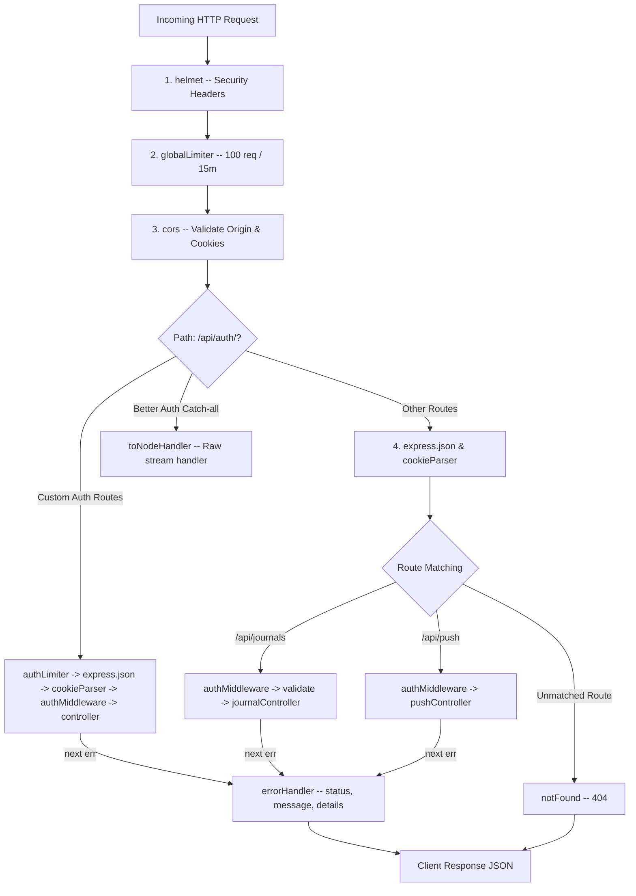

# Express Middleware Fundamentals & Architecture

> Revision guide based on the **MyJournalApp** backend architecture.

---

## 1. What is Middleware?

In Express, a **middleware** is a function executed during the HTTP request-response cycle. It has access to the incoming request (`req`), the outgoing response (`res`), and the `next` function in the application pipeline:

```javascript
function sampleMiddleware(req, res, next) {
  // 1. Inspect or modify req / res
  // 2. Either end the request: res.status(200).json(...)
  // 3. Or pass control forward: next()
  // 4. Or pass an error: next(new Error('Something failed'))
}
```

### The Three Outcomes of Any Middleware

| Action | Code | Result |
| :--- | :--- | :--- |
| **Pass control** | `next()` | Express moves to the next middleware or route handler in line. |
| **Short-circuit** | `res.status(...).json(...)` | The request lifecycle ends here. Downstream middlewares are **not** run. |
| **Trigger error flow** | `next(err)` | Express skips all remaining standard handlers and jumps directly to the nearest 4-parameter error handler. |

---

## 2. Types of Middlewares in Express

### A. Application-Level Middleware (`app.use`)
Binds to the whole Express application instance and runs on requests matching the path (or all requests if no path specified):
```javascript
app.use(express.json())
app.use('/api/journals', journalRoutes)
```

### B. Router-Level Middleware (`router.use`)
Binds to an isolated `express.Router()` instance. Only requests hitting that specific router will trigger it:
```javascript
const router = express.Router()
router.use(authMiddleware) // Protects all routes defined on this router
```

### C. Route-Specific Middleware
Attached directly to individual route definitions:
```javascript
router.post('/', validate(createJournalSchema), journalController.create)
```

### D. Error-Handling Middleware (4 Parameters)
Express identifies error handlers by checking function arity (`fn.length === 4`):
```javascript
function errorHandler(err, req, res, next) {
  res.status(err.statusCode || 500).json({ error: err.message })
}
```

---

## 3. Middlewares in This Codebase

```
backend/
├── middleware/
│   ├── auth.js            <-- Session authentication & user identification
│   ├── validate.js        <-- Request body validation via Zod (Factory pattern)
│   └── errorHandler.js    <-- 404 handler and 4-parameter error responder
└── app.js                 <-- Global security, limiters, CORS, and body parsers
```

---

### 1. `authMiddleware` — Session Authentication
- **File**: [`backend/middleware/auth.js`](file:///c:/Users/mrsan/Desktop/MyJournalApp/backend/middleware/auth.js)
- **Role**: Validates Better Auth session cookies/headers and attaches user context.

```javascript
import { auth } from "../config/auth.js"
import AppError from "../utils/AppError.js"

async function authMiddleware(req, res, next) {
  try {
    const session = await auth.api.getSession({
      headers: req.headers
    })

    if (!session || !session.user) {
      return next(new AppError('Unauthorized: Missing or invalid session', 401))
    }

    // Attach user information to request object for downstream handlers
    req.userId = session.user.id
    req.session = session
    next()
  } catch (err) {
    return next(new AppError('Unauthorized: Session verification failed', 401))
  }
}

export default authMiddleware
```

#### Where & When Used:
1. **[`backend/routes/journals.js:L9`](file:///c:/Users/mrsan/Desktop/MyJournalApp/backend/routes/journals.js#L9)**: `router.use(auth)` — executes before every journal action (`GET`, `POST`, `PUT`, `DELETE`).
2. **[`backend/routes/push.js:L11`](file:///c:/Users/mrsan/Desktop/MyJournalApp/backend/routes/push.js#L11)**: `router.use(auth)` — protects `/subscribe`, `/unsubscribe`, and `/send`.
3. **[`backend/app.js:L63-L64`](file:///c:/Users/mrsan/Desktop/MyJournalApp/backend/app.js#L63-L64)**: Protects custom auth actions (`PUT /api/auth/reminder`, `DELETE /api/auth/deleteaccount`).

---

### 2. `validate(schema)` — Higher-Order Validation Factory
- **File**: [`backend/middleware/validate.js`](file:///c:/Users/mrsan/Desktop/MyJournalApp/backend/middleware/validate.js)
- **Role**: Validates `req.body` against a Zod schema using closures.

```javascript
import AppError from '../utils/AppError.js'

function validate(schema) {
  // Returns the actual (req, res, next) middleware, closing over "schema"
  return (req, res, next) => {
    const result = schema.safeParse(req.body)

    if (!result.success) {
      const details = result.error.errors.map(err => ({
        field: err.path.join('.'),
        message: err.message,
      }))
      return next(new AppError('Validation failed', 400, details))
    }

    // Replace req.body with clean, parsed, and trimmed data
    req.body = result.data
    next()
  }
}

export default validate
```

#### How the Factory & Closure Pattern Works:
```javascript
// 1. Defining schema in journalValidator.js
export const createJournalSchema = z.object({
  title: z.string().min(1).max(100).trim()
})

// 2. In routes/journals.js:
// validate(createJournalSchema) runs when app starts.
// It returns a middleware function that permanently remembers createJournalSchema.
router.post('/', validate(createJournalSchema), journalController.create)
```

- **`schema.safeParse(req.body)`**: Zod method that validates without throwing exceptions. Returns `{ success: true, data }` or `{ success: false, error }`.
- **`req.body = result.data`**: Strips unexpected/malicious extra fields and applies transformations (e.g. `.trim()`).

---

### 3. `notFound` — 404 Fallback
- **File**: [`backend/middleware/errorHandler.js:L1-L3`](file:///c:/Users/mrsan/Desktop/MyJournalApp/backend/middleware/errorHandler.js#L1-L3)
- **Role**: Intercepts any request that did not match an active route.

```javascript
export function notFound(req, res, next) {
  res.status(404).json({ error: 'Route not found' })
}
```

#### Where & When Used:
- Mounted in [`backend/app.js:L85`](file:///c:/Users/mrsan/Desktop/MyJournalApp/backend/app.js#L85) right after all valid routes have been declared.

---

### 4. `errorHandler` — Centralized Error Handling
- **File**: [`backend/middleware/errorHandler.js:L5-L16`](file:///c:/Users/mrsan/Desktop/MyJournalApp/backend/middleware/errorHandler.js#L5-L16)
- **Role**: Catches all errors forwarded by `next(err)` and standardizes client responses.

```javascript
export function errorHandler(err, req, res, next) {
  const statusCode = err.statusCode || 500
  const message = err.message || 'Something went wrong'

  const response = { error: message }
  if (err.details) {
    response.details = err.details
  }

  res.status(statusCode).json(response)
}
```

#### Why 4 Parameters?
Express inspects `Function.length`. A function with 4 arguments `(err, req, res, next)` is registered as an **error handling middleware**. Omitting `next` drops the parameter count to 3, turning it into a regular middleware and breaking error catching.

---

## 4. Pipeline Order in `app.js`

Middlewares execute in the **exact order** they are registered.



### Why Order is Critical:
1. **`helmet()` & `rateLimit()` first**: Filter out bad headers and abusive requests before spending CPU cycles parsing bodies or decrypting cookies.
2. **`Better Auth` before global `express.json()`**: Better Auth reads incoming request streams directly. If `express.json()` reads and consumes the stream first, Better Auth cannot read it.
3. **`express.json()` before application routes**: `req.body` is `undefined` unless parsed before your route handlers run.
4. **`notFound` and `errorHandler` last**: They must sit downstream of all route handlers so unmatched requests or errors fall into them.

---

## 5. Interview Questions & Answers

### Q1: What is Express middleware and what is the role of `next()`?
**Answer:**
A middleware is a function with access to `(req, res, next)`.
- Calling `next()` hands control to the subsequent middleware in the stack.
- Calling `next(err)` (with any argument) tells Express that an error occurred, causing it to bypass all regular middlewares and route handlers and jump straight to the nearest error-handling middleware `(err, req, res, next)`.
- If neither `next()` nor a response method (`res.send()`, `res.json()`) is called, the request hangs until client timeout.

---

### Q2: How does Express differentiate between regular middleware and error-handling middleware?
**Answer:**
Express uses JavaScript's `Function.length` property (arity check).
- A standard middleware has 2 or 3 parameters: `(req, res)` or `(req, res, next)`.
- An error-handling middleware **must declare exactly 4 parameters**: `(err, req, res, next)`.
Even if `next` is not explicitly called inside the error handler, it must still be declared in the function signature, otherwise Express will treat it as a normal middleware.

---

### Q3: What is a "Middleware Factory" and why do we use it with validation libraries like Zod or Joi?
**Answer:**
Express route definitions expect a function signature `(req, res, next)`. To pass dynamic configurations or schemas (e.g. `createJournalSchema` vs `updateJournalSchema`), we wrap the middleware in an outer factory function:

```javascript
function validate(schema) {
  return (req, res, next) => {
    // Has access to schema via JavaScript closure
    const result = schema.safeParse(req.body)
    if (!result.success) return next(new AppError('Validation failed', 400))
    next()
  }
}
```
This enables reusable, schema-agnostic validation logic across different routes.

---

### Q4: What happens if an unhandled promise rejection occurs inside an `async` middleware in Express?
**Answer:**
- In **Express 4**: Unhandled rejections inside async functions do not trigger the error handler automatically. The request hangs or the Node process crashes with an unhandled rejection warning. You must wrap the body in `try/catch` and explicitly call `next(err)`, or use a helper like `express-async-errors`.
- In **Express 5**: Express automatically catches rejected promises from async middlewares and routes, passing them to `next(err)` natively.
- In our codebase ([`backend/middleware/auth.js`](file:///c:/Users/mrsan/Desktop/MyJournalApp/backend/middleware/auth.js)), we use explicit `try/catch` blocks:
  ```javascript
  try {
    const session = await auth.api.getSession(...)
    ...
  } catch (err) {
    return next(new AppError('Unauthorized', 401))
  }
  ```

---

### Q5: What is the difference between `app.use()` and `router.use()`?
**Answer:**
- `app.use()` applies middleware at the application level across the entire Express instance (or sub-paths of the root app).
- `router.use()` scopes middleware specifically to that `Router` instance. For example, in [`backend/routes/journals.js`](file:///c:/Users/mrsan/Desktop/MyJournalApp/backend/routes/journals.js), calling `router.use(auth)` enforces authentication for all journal routes without affecting unauthenticated routes on other routers (such as public push notification keys or health checks).

---

### Q6: Can middleware modify the `req` or `res` objects? Give an example from our project.
**Answer:**
Yes. Because JavaScript objects are passed by reference, any middleware can attach new properties or mutate existing ones.
- In [`authMiddleware`](file:///c:/Users/mrsan/Desktop/MyJournalApp/backend/middleware/auth.js):
  ```javascript
  req.userId = session.user.id
  req.session = session
  ```
  This decorates `req` with `userId`, allowing controllers downstream (`journalController.create`) to directly read `req.userId` without re-verifying the session.
- In [`validate`](file:///c:/Users/mrsan/Desktop/MyJournalApp/backend/middleware/validate.js):
  ```javascript
  req.body = result.data
  ```
  Mutates `req.body` to only contain sanitized, validated data.
