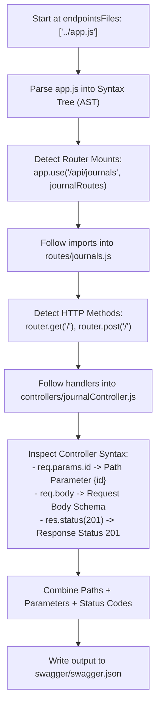

# Swagger API Documentation Architecture

> Technical reference and revision notes based on the **MyJournalApp** backend architecture.

---

## 1. Overview & Dual-Tool Architecture

Swagger is an interactive API documentation suite built on the **OpenAPI Specification**. 

In our application, Swagger is **not** a single monolithic package. It is structured into two separate phases powered by two distinct libraries:

```
                  PHASE 1: GENERATION (Build / CLI Time)
                 ┌──────────────────────────────────────┐
                 │           swagger-autogen            │
                 │ - Scans route and controller files   │
                 │ - Generates OpenAPI JSON document    │
                 │ - Writes to: swagger/swagger.json    │
                 └──────────────────┬───────────────────┘
                                    │ generates
                                    ▼
                              swagger.json
                                    │ imported by
                  PHASE 2: RUNTIME (Serving the Web UI)
                 ┌──────────────────────────────────────┐
                 │         swagger-ui-express           │
                 │ - Mounted as middleware in app.js    │
                 │ - Serves interactive UI at /api-docs │
                 │ - Enables live "Try it out" requests │
                 └──────────────────────────────────────┘
```

| Package | Phase | Purpose |
| :--- | :--- | :--- |
| **`swagger-autogen`** | Build / Script | Static code analyzer that creates [`swagger.json`](file:///c:/Users/mrsan/Desktop/MyJournalApp/backend/swagger/swagger.json). |
| **`swagger-ui-express`** | Runtime | Express middleware that renders the interactive documentation UI at `/api-docs`. |

---

## 2. Configuration Breakdown

### 1. Generator Script — [`backend/swagger/swagger.js`](file:///c:/Users/mrsan/Desktop/MyJournalApp/backend/swagger/swagger.js)

```javascript
import swaggerAutogen from 'swagger-autogen'

const doc = {
  info: {
    title: 'Journal API',
    description: 'Auto-generated interactive API documentation for the Journal App backend.',
    version: '1.0.0'
  },
  host: 'localhost:3000',
  schemes: ['http'],
  securityDefinitions: {
    cookieAuth: {
      type: 'apiKey',
      in: 'cookie',
      name: 'jwt'
    },
    bearerAuth: {
      type: 'apiKey',
      in: 'header',
      name: 'Authorization',
      description: 'Enter your Bearer token in the format: Bearer <token>'
    }
  }
}

// Destination for the generated OpenAPI spec
const outputFile = './swagger.json'

// Starting point for the static code scanner
const endpointsFiles = ['../app.js']

swaggerAutogen()(outputFile, endpointsFiles, doc).then(() => {
  console.log('Swagger documentation generated successfully at swagger/swagger.json')
})
```

- **`doc`**: Static OpenAPI metadata describing the API, host address, and authentication mechanisms (`cookieAuth` and `bearerAuth`).
- **`endpointsFiles: ['../app.js']`**: The root file for the scraper. You only provide `app.js`; the tool traces subsequent imports recursively.
- **`outputFile: './swagger.json'`**: The output file path where the generated JSON specification is saved.

---

### 2. Serving Swagger in Express — [`backend/app.js`](file:///c:/Users/mrsan/Desktop/MyJournalApp/backend/app.js)

```javascript
import swaggerUi from 'swagger-ui-express'
import { createRequire } from 'module'

// Since swagger.json is a JSON file, createRequire is the standard ESM way to import JSON
const require = createRequire(import.meta.url)
const swaggerDocument = require('./swagger/swagger.json')

// Serve interactive Swagger API docs at /api-docs
app.use('/api-docs', swaggerUi.serve, swaggerUi.setup(swaggerDocument))
```

- **`createRequire(import.meta.url)`**: In standard Node.js ES Modules (ESM), importing JSON files directly via `import ... from './swagger.json'` requires experimental import assertion flags. Using `createRequire` allows stable, synchronous loading of the JSON spec file.
- **`swaggerUi.serve`**: Built-in middleware providing the static HTML, CSS, and JavaScript assets for Swagger UI.
- **`swaggerUi.setup(swaggerDocument)`**: Middleware that injects the parsed OpenAPI JSON specification into the Swagger UI frontend.

---

## 3. How Swagger "Scrapes" All Endpoints Under the Hood

The package `swagger-autogen` **does NOT start your Express server or make network requests**.

Instead, it performs **Static Code Analysis via AST (Abstract Syntax Tree) Parsing**:



### The 4 Internal Steps:

1. **Import Graph Traversal**:
   `swagger-autogen` reads `app.js`. When it encounters `import journalRoutes from './routes/journals.js'`, it recursively parses that file from disk without executing the server.
2. **Path Prefix Calculation**:
   It matches mounts in `app.js` with router definitions:
   - Mount in `app.js`: `/api/journals`
   - Route in `journals.js`: `/:id`
   - **Resolved endpoint**: `/api/journals/{id}`
3. **Parameter and Body Inference**:
   It inspects controller function bodies for Express variable usage:
   - `req.params.id` $\rightarrow$ Marks `{id}` as a required URL path parameter.
   - `req.body` $\rightarrow$ Generates an expected JSON request payload.
   - `res.status(201)` $\rightarrow$ Documents that HTTP 201 is a possible status response.
4. **JSDoc & Inline Swagger Annotations**:
   It looks for comments written directly above routes to enrich the schema:
   ```javascript
   // #swagger.tags = ['Journals']
   // #swagger.description = 'Fetch a journal by ID'
   router.get('/:id', journalController.getById)
   ```

---

## 4. Daily Developer Workflow

```
1. Add or modify route/controller in code
                  │
                  ▼
2. Run generation script:
   npm run swagger
                  │
                  ▼
3. swagger.json is regenerated
                  │
                  ▼
4. Run server:
   npm run dev
                  │
                  ▼
5. Open browser at:
   http://localhost:3000/api-docs
```

> **Important**: `swagger.json` does **not** update automatically when saving code files. Whenever routes, parameters, or controllers are modified, `npm run swagger` must be run to re-crawl the codebase.

---

## 5. Interview Questions & Answers

### Q1: What is the difference between `swagger-autogen` and `swagger-ui-express`?
**Answer:**
`swagger-autogen` is a build-time generator that statically analyzes your Express code and outputs an OpenAPI specification (`swagger.json`). `swagger-ui-express` is a runtime middleware that serves the HTML/CSS/JS frontend to render `swagger.json` as an interactive documentation webpage at `/api-docs`.

---

### Q2: How does automated documentation scraping discover endpoints without running the server?
**Answer:**
It uses Static Code Analysis (AST parsing). The tool reads the source code files as text, traverses the JavaScript Abstract Syntax Tree starting from the entry point (`app.js`), follows `import` statements into route files, and identifies Express router calls (`router.get`, `router.post`). It then inspects the handler bodies for references to `req.params`, `req.body`, and `res.status()` to deduce inputs and responses.

---

### Q3: Why doesn't Swagger documentation update immediately when you edit a route?
**Answer:**
Because the documentation is served from a static file (`swagger.json`). The code analysis only executes when explicitly triggered via `npm run swagger` (`node swagger/swagger.js`). The server does not regenerate the JSON file on the fly during request handling to preserve runtime performance.

---

### Q4: How is authentication documented and tested in Swagger UI?
**Answer:**
Authentication is declared in `swagger.js` under `securityDefinitions` (e.g. `bearerAuth` for JWT headers or `cookieAuth` for session cookies). In the Swagger UI, an **Authorize** button appears. Developers can log in, copy their token, paste it into the Authorize modal, and Swagger UI will automatically attach the `Authorization: Bearer <token>` header to all subsequent "Try it out" test requests.
